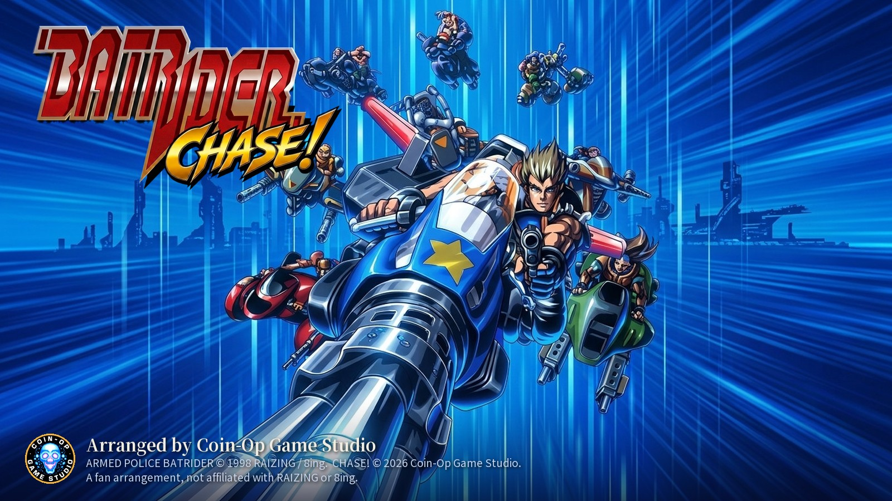
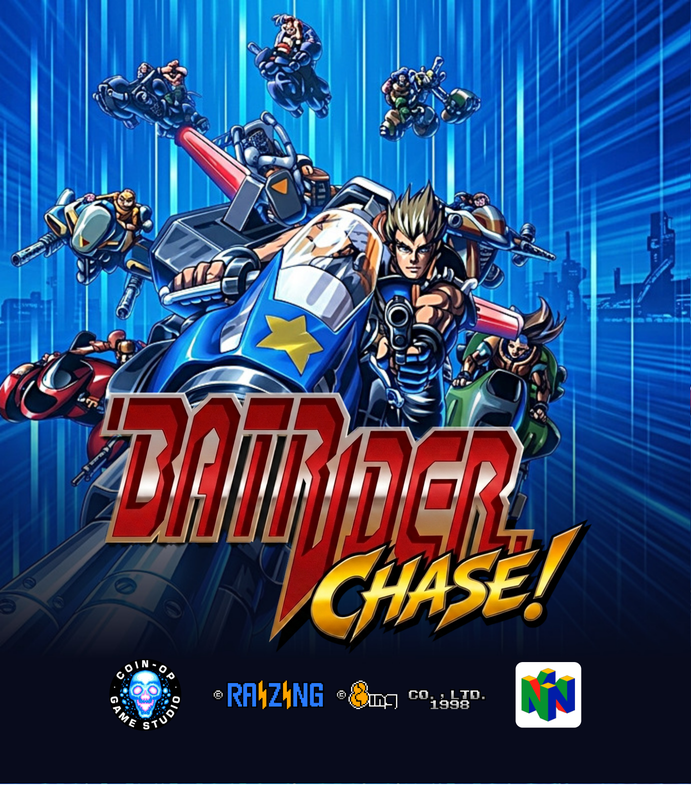

# Batrider: Chase! — N64 · PS Vita

<p align="center">
  
</p>

**Batrider: Chase!** is an arrangement of Raizing's 1998 arcade shooter *Armed Police Batrider* by **Coin-Op Game
Studio**: **CHASE!**, an arranged mode with a chain to build, medals that fly to you, the Chase Break, and a rank that
stays within reach. This repository holds the **player's kit**, which builds the game for two systems from **your own
copy of the arcade ROMs**:

| System | You get | Runs on |
|---|---|---|
| **Nintendo 64** | `batrider_n64_chase.z64` | a flash cart (SummerCart64, EverDrive 64) with the 8 MB **Expansion Pak** |
| **PS Vita** | `batrider_vita.vpk` | a Vita running HENkaku / Enso, installed with VitaShell |

Both versions include both games on one title screen: **CHASE!** and the **original Armed Police Batrider** (1998), as
the arcade board plays it. Each keeps its own high scores.

**This repository contains no readable game data.** The kit's packages are encrypted with a key computed from the
arcade ROM images: they open only with correct dumps, so the kit is of no use without your own ROMs. Nothing is
downloaded.

## What's here

| Folder | Contents |
|---|---|
| [`Batrider_Chase_Kit/`](Batrider_Chase_Kit) | the builder kit: `batrider-kit` for Windows, Linux and macOS, the sealed packages (`kit/`) and the kit's own [`README.txt`](Batrider_Chase_Kit/README.txt) |
| [`n64/`](n64) | the N64 **instruction booklet** (English and Japanese, plus print-ready sheets) and the **cartridge label and box art** for making a physical copy. See [`n64/README.md`](n64/README.md) |
| [`images/`](images) | previews used on this page |

## Quick start

### 1. Get the ROMs

You need MAME's **`batriderj`** set: *Armed Police Batrider*, Japan, B version (Fri Feb 13 1998). Any of these work:

- split sets: `batriderj.zip` + its parent `batrider.zip`,
- one merged `batrider.zip` that holds the `batriderj` clone,
- a non-merged `batriderj.zip`,
- loose files in a folder.

Every file is checked against its size, CRC32 and SHA-1. These are the eleven files the kit looks for:

```
prg0b.u22  prg1b.u23  prg2.u21  prg3.u24     program
snd.u77                                      sound program
rom-1.bin  rom-2.bin  rom-3.bin  rom-4.bin   graphics
rom-5.bin  rom-6.bin                         sound samples
```

The other versions (Europe, USA, China, Korea, Taiwan, and the Japanese A version from 1997) have a different program
and will not open the kit.

### 2. Run the kit

**Windows:** put your ROM zips in `Batrider_Chase_Kit/roms/` and double-click `batrider-kit.exe`.

**Linux / macOS:** open a terminal in `Batrider_Chase_Kit/` and run the program for your system:

```bash
chmod +x batrider-kit-linux            # once, if your download lost the executable bit
./batrider-kit-linux
```

On macOS, use `batrider-kit-macos-arm64` (Apple silicon) or `batrider-kit-macos-intel` (Intel). If macOS refuses to
open a program from the internet, right-click it, choose **Open**, then **Open** again.

**More options** (the same on every system):

```
batrider-kit                                    both systems, ROMs from the roms folder
batrider-kit n64                                the N64 only
batrider-kit vita                               the Vita only
batrider-kit --roms D:\mame\roms                ROMs from another folder
batrider-kit --out D:\out                       another output folder
```

The results go to `Batrider_Chase_Kit/output/`, in `n64/`, `vita/` and `manual/` (the instruction booklets for both
consoles). The kit checks each package before it writes it.

### 3. Install

**Nintendo 64.** Copy `output/n64/batrider_n64_chase.z64` to your flash cart's SD card. The console needs the
**Expansion Pak**. The save type is **EEPROM 16K**: the ROM's header says so, but if your cart's menu asks, or saves
don't stick, choose EEPROM 16K by hand.

**PS Vita.** Copy `output/vita/batrider_vita.vpk` to the Vita and install it with **VitaShell**. Its bubble,
**Batrider: Chase!**, then appears on the home screen.

## Controls

| | Nintendo 64 | PS Vita |
|---|---|---|
| Move | Control Stick or Control Pad | left stick or directional buttons |
| Shot (hold to fire) | A | Cross |
| Bomb | B | Circle |
| Special (the options' formation; in CHASE!, the Chase Break) | Z | Square |
| Start / continue | START | START |
| Pause | START (during a stage) or C-left | SELECT |
| Host menu | L + R together | L + R together |

The game's OPTIONS can move Shot, Bomb and Special among the three buttons. The host menu sets the **MODE** (CHASE! or
ORIGINAL) and the language; on the N64 it also sets the screen layout (a TV turned on its side, **TATE**, or an upright
one, **YOKO**). The Vita adds gadget columns beside the game. The full guide is in each system's instruction booklet.

## Troubleshooting

The kit lists any problem with your ROMs:

- **Not found (or not the right version)**: those files weren't in what you gave the kit, or a file of that name is
  not the right dump (another version's, or a patched or damaged file). Most often it's the parent `batrider.zip`,
  missing beside a split `batriderj.zip`.
- **The ROM set checks out but does not open this kit**: the kit is from another version of the game.
- **The kit's files were not found**: keep the `kit/` folder beside the program, as it came.

On the N64, a black screen or **Expansion Pak required** at power-on means the console has no Expansion Pak fitted.

## Making a physical N64 copy

[`n64/`](n64) has everything to print: the 117 × 173 mm instruction booklet, the die-cut cartridge label and the
NTSC-U style box. [`n64/README.md`](n64/README.md) covers what cartridge to order (512 Mbit, EEPROM 16K, CIC 6102 /
7101) and how to print each piece.

<p align="center">
  
</p>

## Legal

The kit holds no readable data from the arcade ROMs. The packages you make from it **do** hold data from your ROM
images: they are for your own use, not for distribution. Please don't share the `.z64` or `.vpk` you make.

*Armed Police Batrider* is © 1998 Raizing / 8ing. *Batrider: Chase!* is a fan arrangement by Coin-Op Game Studio and is
not affiliated with or endorsed by Raizing, 8ing, Nintendo or Sony. Nintendo 64 and PS Vita are trademarks of their
respective owners.
